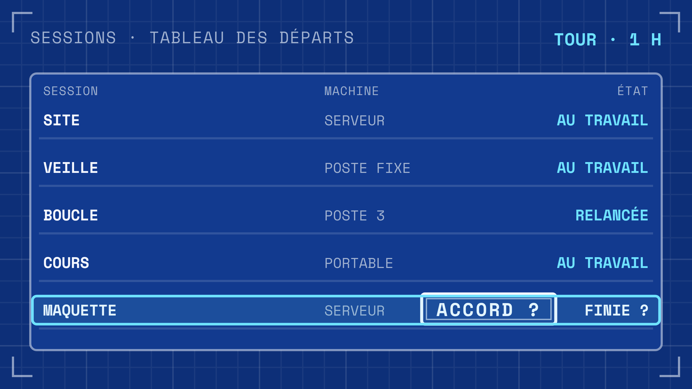
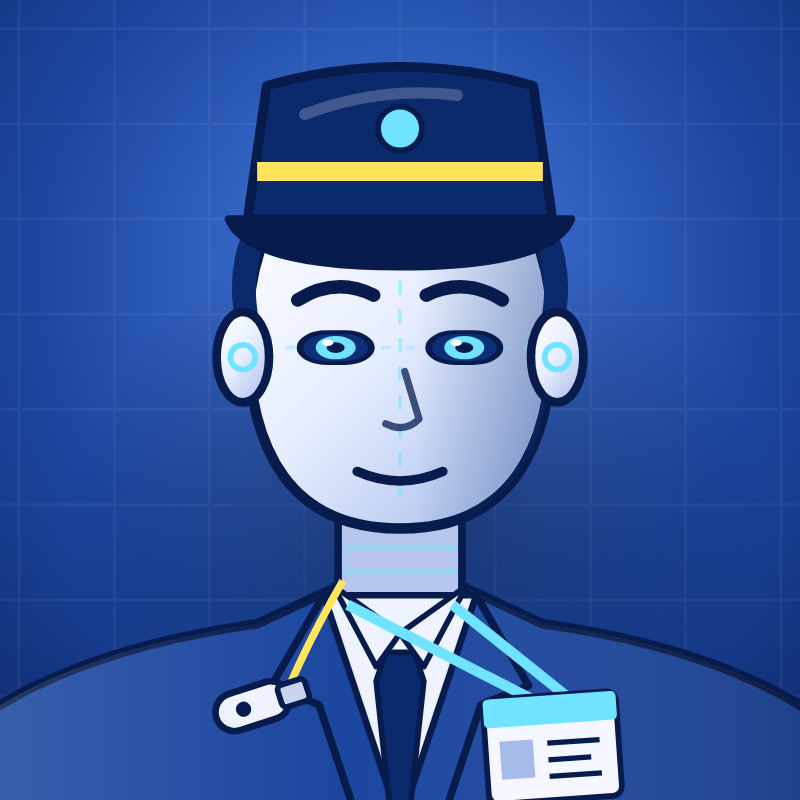

[English](README.md) · **Français**

**Anthony Hunt** · [Fiche du projet sur ingevision.cloud](https://ingevision.cloud/agents-ia/?p=agent-manager) · [LinkedIn](https://www.linkedin.com/in/anthony-hunt-3948a9196) · [Profil GitHub](https://github.com/anthohunt)

> Dépôt vitrine : le code et les données de ce projet sont privés ; ce README le décrit.

# Agent - Manager des sessions

**Un agent permanent qui fait le tour de toutes mes autres sessions d'agents de code à heure fixe, relance celles qui ont planté, n'en ferme jamais une sans mon accord, et ne me remonte que les décisions qui me reviennent vraiment.**

## Le problème

Avec une douzaine de sessions d'agents qui tournent longtemps, réparties sur un serveur, un poste fixe et un portable, il y a toujours quelque chose qui coince quand personne ne regarde : une session plante la nuit, une autre attend une réponse que personne ne donne, une troisième a fini et reste là. Courir après ses agents à la main enlève tout l'intérêt d'en avoir.

## Ce que fait le manager

- **Un tour toutes les heures le jour, toutes les deux heures et demie la nuit.** Un petit programme liste toutes les sessions et n'affiche que celles qui demandent un geste : plantée, endormie, en attente d'une décision, qui demande à être fermée.
- **Plantée ou endormie : relancée sans demander**, puis notée en une ligne. Une session peut aussi être rouverte à l'identique, avec sa conversation.
- **Aucune fermeture automatique.** Une session finie demande à être fermée ; le manager transmet, et ne la ferme qu'après le oui du propriétaire.
- **Les questions des sessions passent par un tableau de délégation écrit.** Pour chaque type de décision, il dit si le manager décide seul, décide et prévient, ou transmet seulement. Le tableau s'étoffe à mesure que le propriétaire lui en confie davantage.
- **Le travail lourd part ailleurs.** Le serveur reste une tour de contrôle ; une session qui y lance une compilation ou un navigateur est priée de l'envoyer sur la machine de son projet.

## Son compagnon : le pilotage de la flotte

Le tableau de bord des sessions, l'aiguillage des nouvelles demandes, la revérification des résultats annoncés par un agent neuf et le bilan du lundi sont partagés avec le reste de la flotte. Ils sont décrits dans leur propre vitrine : [Pilotage de la flotte d'agents](https://github.com/anthohunt/agent-fleet-dashboard-showcase).

## Ce qui est construit

En service depuis le 27 octobre 2026, sous forme d'une session Claude Code permanente pilotable à distance. Il travaille avec un second agent permanent qui garde les postes partagés ([Agent - Gardien du parc](https://github.com/anthohunt/agent-fleet-keeper-showcase)), et un chercheur de nuit relit sa journée pour proposer des améliorations ([Agent - Chercheur du management](https://github.com/anthohunt/agent-chercheur-management)).

## Ce qui est public

Cette page seulement. Les sessions, journaux et réglages décrivent une installation privée.

## Outils

- Claude Code (session permanente, contrôle à distance)
- Python (tour, relances, tableau de délégation)
- tmux, systemd, cron
- Tailscale et SSH entre les machines
