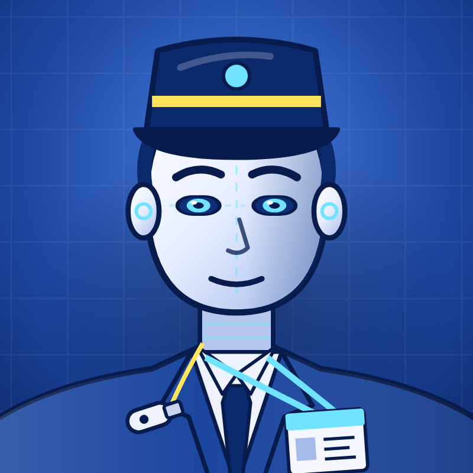

**English** · [Français](README.fr.md)

**Anthony Hunt** · [Project page on ingevision.cloud](https://ingevision.cloud/en/ai-agents/?p=agent-manager) · [LinkedIn](https://www.linkedin.com/in/anthony-hunt-3948a9196) · [GitHub profile](https://github.com/anthohunt)

> Showcase repository: the code and data of this project are private; this README describes it.

# Agent - Session manager

**A permanent agent that goes round all my other coding-agent sessions on a schedule, restarts the ones that crashed, never closes one without my yes, and only comes to me with the decisions that are really mine.**

## The problem

With a dozen long-running agent sessions spread over a server, a home workstation and a laptop, something always goes wrong while nobody is looking: a session crashes at night, another waits for an answer nobody gives, a third has finished and sits there. Running after agents by hand defeats the point of having them.

## What the manager does

- **A round every hour by day, every two and a half hours at night.** A small program lists every session and prints only those that need action: crashed, asleep, waiting for a decision, asking to be closed.
- **Crashed or asleep: restarted without asking**, then logged in one line. A session can also be reopened exactly as it was, with its conversation.
- **Closing is never automatic.** A finished session asks to be closed; the manager passes the request on and closes it only after the owner says yes.
- **Questions from sessions go through a written delegation table.** For each kind of decision, the table says whether the manager decides alone, decides and tells the owner, or only passes it on. The table grows as the owner hands over more.
- **Heavy work goes elsewhere.** The server is kept as a control tower; a session that starts a build or a browser there is asked to move it to the machine of its project.

## Its companion: the fleet dashboard

The dashboard of the sessions, the routing of new requests, the re-checking of announced results by a fresh agent and the Monday report are shared with the rest of the fleet. They are described in their own showcase: [Agent fleet dashboard](https://github.com/anthohunt/agent-fleet-dashboard-showcase).

## What is built

In service since 27 October 2026, as a permanent Claude Code session under remote control. It works alongside a second permanent agent that keeps the shared workstations ([Agent - Workstation fleet keeper](https://github.com/anthohunt/agent-fleet-keeper-showcase)), and a night researcher reads its day to suggest improvements ([Agent - Management Researcher](https://github.com/anthohunt/agent-chercheur-management)).

## What is public

This page only. The sessions, logs and settings describe a private setup.

## Tech stack

- Claude Code (permanent session, remote control)
- Python (round, restarts, delegation table)
- tmux, systemd, cron
- Tailscale and SSH between the machines
