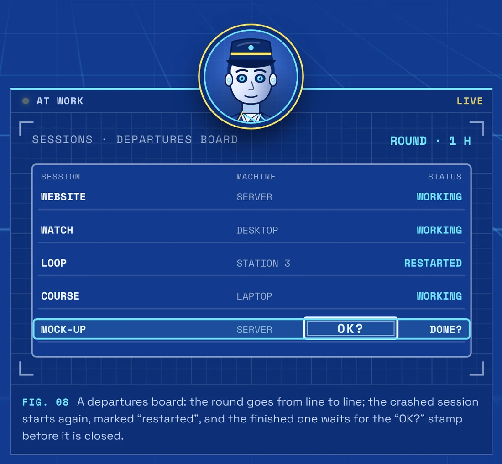
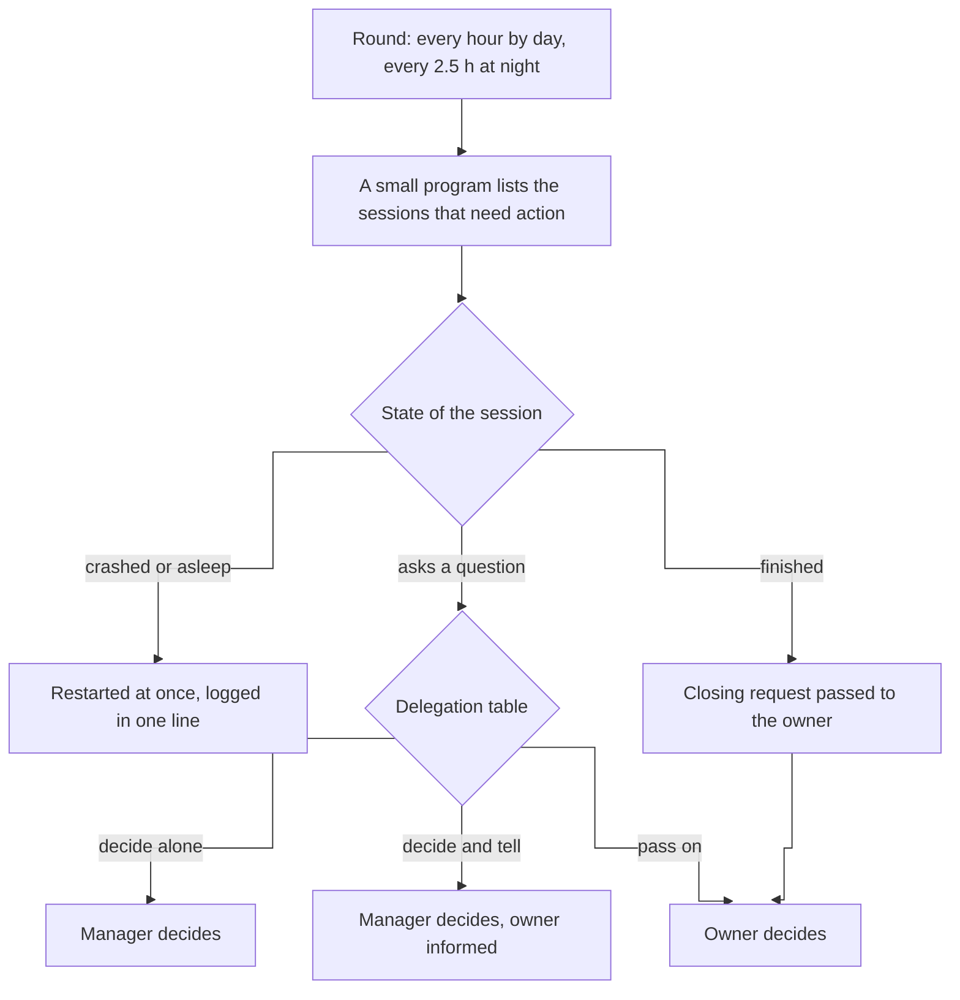
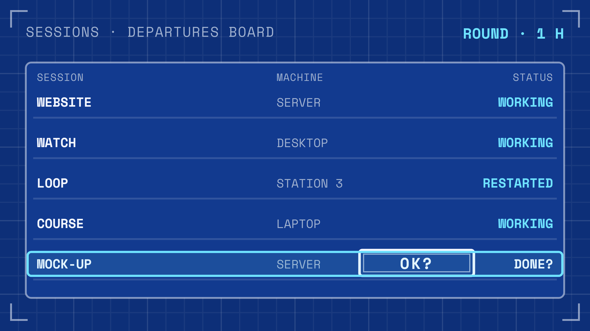
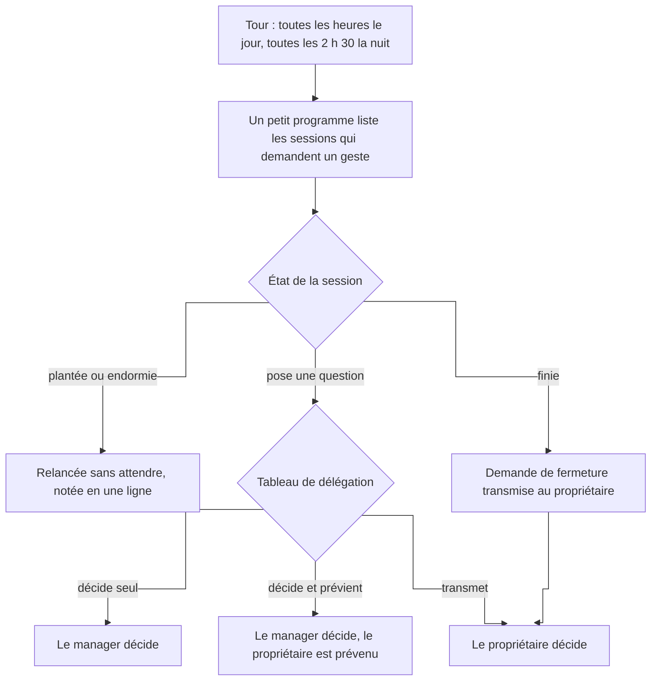
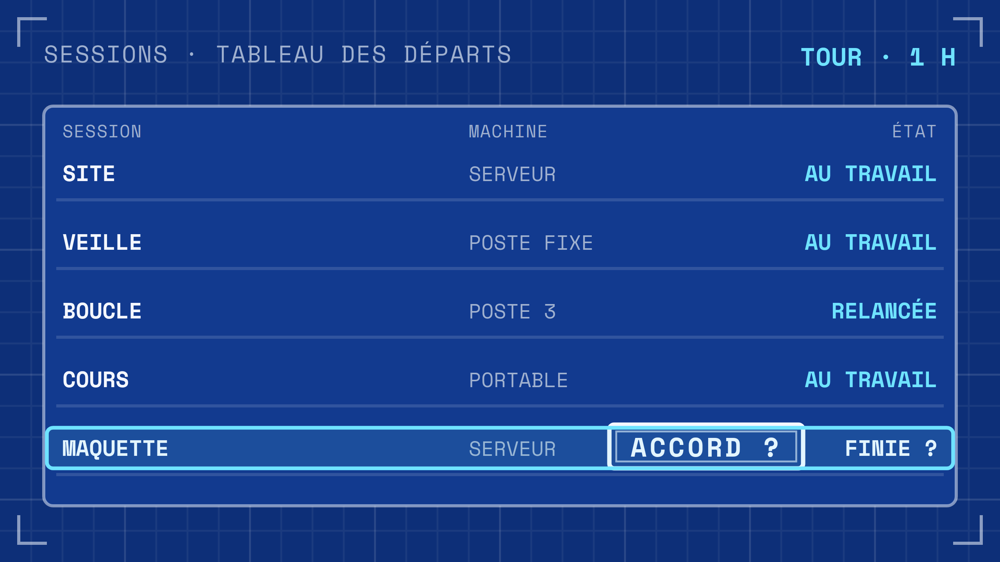

# Agent - Session manager

It goes round every agent session, restarts the ones that crashed and only brings up the real decisions.

**English** · [Français](#version-française)

> Showcase repository: the code and data of this project are private; this README describes it.

*Nobody stays stuck for more than one round.*

## What it does

- **Goes round the sessions, day and night**: every hour by day, every two and a half hours at night.
- **Restarts a crashed or sleeping session** at once, then logs it in one line. A session can also be reopened exactly as it was, with its conversation.
- **Closes nothing without the owner's yes.** A finished session asks to be closed; the manager passes the request on and closes it only after the owner agrees.
- **Settles what the delegation table leaves to it.** For each kind of question a session asks, a written table says whether the manager decides alone, decides and tells the owner, or only passes it on. The table grows as the owner hands over more.
- **Sends heavy work elsewhere.** The server is kept as a control tower; a session that starts a build or a browser there is asked to move it to the machine of its project.

It is meant for someone who runs many coding agents at once, on several machines.

## How it works

| Does on its own | Brings to the owner |
|---|---|
| Restart a session, reopen it as it was, send heavy work to another machine, log every action. | Closing a session, and the decisions the delegation table keeps for the owner. |

### Its companions

- The dashboard of the sessions, the routing of new requests, the re-checking of announced results by a fresh agent and the Monday report are shared with the rest of the fleet: see [Agent fleet dashboard](https://github.com/anthohunt/agent-fleet-dashboard-showcase).
- A second permanent agent keeps the shared workstations: [Agent - Workstation fleet keeper](https://github.com/anthohunt/agent-fleet-keeper-showcase).
- A night researcher rereads its day and suggests improvements: [Agent - Management Researcher](https://github.com/anthohunt/agent-chercheur-management).

## What it runs on

In service since 27 October 2026, as a permanent Claude Code session on a server, under remote control; at each round a small program lists the sessions that need action. The code is not published, so there is nothing to install from this repository.

- Claude Code (permanent session, remote control)
- Python (round, restarts, delegation table)
- tmux, systemd, cron
- Tailscale and SSH between the machines

## Its page

- English: <https://ingevision.cloud/en/ai-agents/?p=agent-manager>
- Français : <https://ingevision.cloud/agents-ia/?p=agent-manager>

---

## Version française

# Agent - Manager des sessions

Il fait le tour de toutes les sessions d'agents, relance celles qui ont planté et ne remonte que les vraies décisions.

> Dépôt vitrine : le code et les données de ce projet sont privés ; ce README le décrit.

*Personne ne reste en panne plus d'un tour.*

### Ce qu'il fait

- **Fait le tour des sessions, de jour comme de nuit** : toutes les heures le jour, toutes les deux heures et demie la nuit.
- **Relance une session plantée ou endormie** sans attendre, puis la note en une ligne. Une session peut aussi être rouverte à l'identique, avec sa conversation.
- **Ne ferme rien sans l'accord du propriétaire.** Une session finie demande à être fermée ; le manager transmet, et ne la ferme qu'après le oui du propriétaire.
- **Tranche ce que le tableau de délégation lui confie.** Pour chaque type de question qu'une session lui pose, un tableau écrit dit s'il décide seul, décide et prévient, ou transmet seulement. Le tableau s'étoffe à mesure que le propriétaire lui en confie davantage.
- **Envoie le travail lourd ailleurs.** Le serveur reste une tour de contrôle ; une session qui y lance une compilation ou un navigateur est priée de l'envoyer sur la machine de son projet.

Il sert à quelqu'un qui fait travailler beaucoup d'agents de code en même temps, sur plusieurs machines.

### Comment il marche

| Fait seul | Remonte au propriétaire |
|---|---|
| Relancer une session, la rouvrir à l'identique, envoyer un travail lourd sur une autre machine, noter chaque geste. | Fermer une session, et les décisions que le tableau de délégation réserve au propriétaire. |

#### Ses compagnons

- Le tableau de bord des sessions, l'aiguillage des nouvelles demandes, la revérification des résultats annoncés par un agent neuf et le bilan du lundi sont partagés avec le reste de la flotte : voir [Pilotage de la flotte d'agents](https://github.com/anthohunt/agent-fleet-dashboard-showcase).
- Un second agent permanent garde les postes partagés : [Agent - Gardien du parc](https://github.com/anthohunt/agent-fleet-keeper-showcase).
- Un chercheur de nuit relit sa journée et propose des améliorations : [Agent - Chercheur du management](https://github.com/anthohunt/agent-chercheur-management).

### Où il tourne

En service depuis le 27 octobre 2026, sous forme d'une session Claude Code permanente sur un serveur, pilotable à distance ; à chaque tour, un petit programme liste les sessions qui demandent un geste. Le code n'est pas publié : il n'y a rien à installer depuis ce dépôt.

- Claude Code (session permanente, contrôle à distance)
- Python (tour, relances, tableau de délégation)
- tmux, systemd, cron
- Tailscale et SSH entre les machines

### Sa fiche

- Français : <https://ingevision.cloud/agents-ia/?p=agent-manager>
- English: <https://ingevision.cloud/en/ai-agents/?p=agent-manager>

---

**Anthony Hunt** · [Agent page on ingevision.cloud](https://ingevision.cloud/en/ai-agents/?p=agent-manager) · [LinkedIn](https://www.linkedin.com/in/anthony-hunt-3948a9196) · [GitHub profile](https://github.com/anthohunt) · anthony@ingevision.cloud
